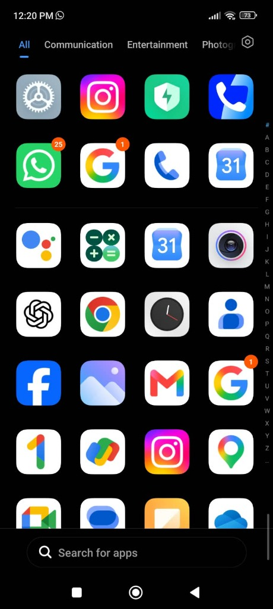
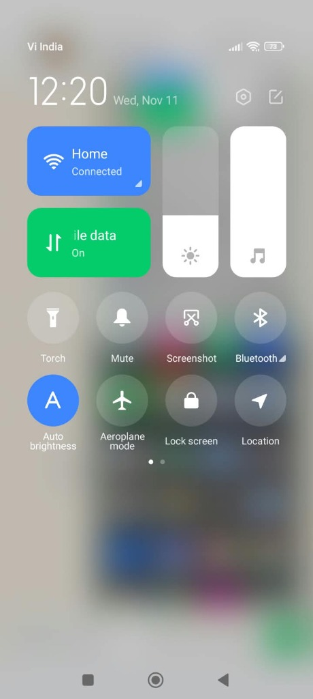
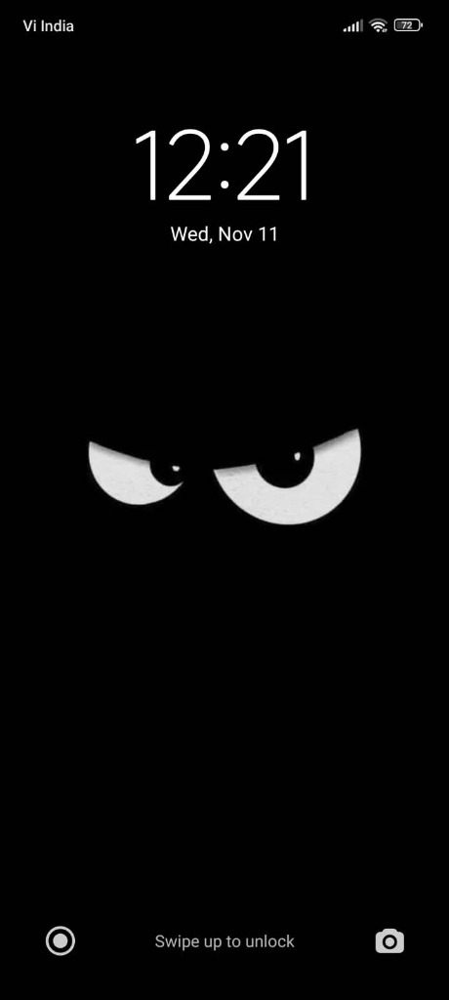

<div align="center">
  
  <h1>Clean Android UI</h1>
  <p><strong>No bloatware apps, no ads — clean, organized, reversible Android &amp; Xiaomi (MIUI / HyperOS) UI strictly on your existing OS.</strong></p>
</div>

> [!IMPORTANT]
> **NO OS change. NO custom ROM. NO bootloader unlock. NO root required.**
> Clean Android UI (Clean MIUI AI) configures your **existing stock Android system** using standard ADB (`pm`, `settings`, `appops`, `wm`) and built-in phone Settings — **no custom ROM, no bootloader unlock, and no root**. However, OEM warranty/service policies vary, USB/Wireless Debugging triggers fraud checks in some **banking/UPI** apps until turned off, and rollback limits depend on backup completeness and Android/OEM ADB install permissions (see [Honest Scope, Compatibility & Limitations](#honest-scope-compatibility--limitations)).

---

## Real-Device Result (Redmi Note 10S — Existing Stock OS)

<table>
  <tr>
    <td align="center">
      <br />
      <sub><b>Organized App Drawer</b><br />Stock Google essentials only — zero bloatware clutter</sub>
    </td>
    <td align="center">
      <br />
      <sub><b>Crisp Control Center</b><br />New MIUI Control Center + <code>440 dpi</code> &amp; Small text scaling</sub>
    </td>
    <td align="center">
      <br />
      <sub><b>Minimal Lock Screen</b><br />Clean dark layout — Glance carousel &amp; promos removed</sub>
    </td>
  </tr>
</table>

---

## What It Does

1. **One-Click Backup & Restore Check FIRST:** Captures your device inventory, package states, settings (`system`/`secure`/`global`), and pullable third-party/user-0 APKs (with SHA-256 + ZIP checks, skipping protected core/Google/unaudited system APKs and packages over 120 MB unless allowed), then runs `restore.py --dry-run` (verifying local backup integrity and generating a dry-run plan — **not** testing live ADB write permissions) **before** changing a single app.
2. **Removes Ads & Bloatware Safely:** Targets ad daemons, trackers, carrier/partner stubs, and unwanted OEM duplicates without touching Android core, SystemUI, Play Services, Telephony, Settings, Mi Cloud / Find Device, active Launcher, or active Keyboard.
3. **Optional "Stock Google" Look + Control Center Polish:** Lets you remove duplicate OEM tools (Browser, File Manager, Facemoji Keyboard, Calculator, Calendar) *only if* clean replacements (`Chrome`, `Files by Google`, `Gboard`, `Google Calculator`, `Google Calendar`) are already installed — plus guides you through Control Center layout, crisp `440 dpi` / `392dp` scaling, clean App Drawer categories, and optional Private DNS ad blocking.
4. **Universal AI Bundle:** Includes an Antigravity plugin (`plugin.json` + `.agents/skills.json`), a full phased workflow skill ([`skills/clean-miui-ai/SKILL.md`](skills/clean-miui-ai/SKILL.md)), safety rules ([`AGENTS.md`](AGENTS.md), [`rules/AGENTS.md`](rules/AGENTS.md), [`GEMINI.md`](GEMINI.md), [`CLAUDE.md`](CLAUDE.md)), and cross-platform One-Click `.bat` / `.sh` scripts.

---

## Supported Devices & Tested Baseline

| Scope | Status | Notes |
| :--- | :--- | :--- |
| **Redmi Note 10S (`M2101K7BI`, Android 13 / MIUI Global `14.0.11.0.TKLINXM`)** | Tested Preset (`profiles/xiaomi_miui_hyperos_clean.json`) | **TESTED:** Tier A (ads/bloat) + Tier B (Google Stock replacements with prerequisite checks) + AppOps presets (`com.google.android.apps.safetyhub` is opt-in via `--include-optional`) |
| **Other Xiaomi / Redmi / POCO (MIUI 12–14 & HyperOS)** | Xiaomi Preset (**UNTESTED — explicit opt-in required**) | **UNTESTED:** Requires `--allow-untested-device` in `analyze_backup.py`; manufacturer match passes, but exact firmware/package behavior is unverified — inspect the draft plan before applying |
| **All Other Android OEMs (Samsung, Pixel, OnePlus, Motorola, Nothing, etc.)** | Conservative Cross-OEM Fallback (`profiles/generic_android_audit.json`) | **UNTESTED:** Cross-OEM guard blocks `xiaomi_miui_hyperos_clean.json`; `generic_android_audit.json` automatically proposes `uninstall_user0` only for universal Meta preinstall stubs (`com.facebook.system`, `com.facebook.appmanager`, `com.facebook.services`) in an unapproved draft plan while requiring manual inspection of `packages_inventory.json` for OEM apps |

---

## 3-Step Quickstart

### 1. Install or Clone the Bundle

**Option A — Clone & open in any AI coding assistant (Antigravity, Claude Code, Cursor, Codex, Gemini CLI):**
```bash
git clone https://github.com/BharatAdhana/clean-android-ui.git
cd clean-android-ui
```

**Option B — Use as an Antigravity Plugin:**
Open the Plugins manager in Antigravity and install/load this repository folder (powered by [`plugin.json`](plugin.json), [`rules/AGENTS.md`](rules/AGENTS.md), and [`skills/clean-miui-ai/SKILL.md`](skills/clean-miui-ai/SKILL.md)).

**Option C — Double-Click Backups Without an AI:**
- **Windows:** Double-click `OneClick_Backup.bat` (creates backup + runs restore `--dry-run`) or `OneClick_Restore.bat`
- **macOS / Linux:** Run `bash oneclick_backup.sh` or `bash oneclick_restore.sh` (or run `chmod +x oneclick_*.sh` once and execute `./oneclick_backup.sh`)

---

### 2. One-Time Connection Setup (USB or Same-Wi-Fi Wireless)

Follow [`docs/CONNECTION_GUIDE.md`](docs/CONNECTION_GUIDE.md) once:
1. Enable **Developer options** on your phone.
2. Turn on **USB debugging** (plug in cable) **OR** **Wireless debugging** (same Wi-Fi network as your PC).
3. *(Optional on Xiaomi MIUI/HyperOS)* Turn on **USB debugging (Security settings)** if you also want ADB-assisted `settings` / `appops` / `wm density` tweaks.
4. Check connection on your computer:
   ```bash
   python scripts/adb_helper.py doctor
   ```

---

### 3. Paste This Prompt to Your AI

More variations live in [`QUICKSTART_PROMPTS.md`](QUICKSTART_PROMPTS.md). Here is the standard prompt:

```text
Use this repository (AGENTS.md and skills/clean-miui-ai/SKILL.md) to clean and organize my phone on its existing OS (no root, no ROM flash).

My details:
- Phone Brand & Model: <e.g., Redmi Note 10S / POCO X5 / Samsung>
- OS / Version: <e.g., MIUI 14 / HyperOS / Android 14>
- Connection: <USB cable OR Wireless ADB on same Wi-Fi — IP:Port & pairing code if needed>
- Goal: <Clean Google Stock style + remove bloat/ads OR Remove ads & bloat only>

First run `adb_helper.py doctor` and help me connect if needed. Next, take a full One-Click Backup and verify `restore.py --dry-run` before touching anything. Then inspect the backup, show me an itemized proposal table with safety notes, and wait for my approval before applying changes. Finally verify the phone and walk me through the UI & Control Center polish steps in docs/UI_AND_CONTROL_CENTER_GUIDE.md.
```

---

## How the Safety Architecture Works

Every cleanup run strictly enforces multiple independent layers of protection:

1. **Mandatory Backup + Dry-Run Verification First:**
   - [`scripts/inspect_and_backup.py`](scripts/inspect_and_backup.py) snapshots `packages_inventory.json`, `settings_{system,secure,global}.txt`, `ad_tracking_audit.json`, `device_info.json`, `summary.json`, `apk_manifest.json` (including `excluded_from_apk_pull`, `skipped_or_failed`, and `completeness_summary`), and pullable local APKs into unique `backups/<YYYYMMDD_HHMMSS>_<MODEL>/` folders, updating `backups/LATEST_BACKUP.txt`.
   - [`scripts/restore.py`](scripts/restore.py) `--dry-run` verifies every pulled APK's SHA-256 hash and ZIP integrity locally and previews planned rollback actions without mutating the device or backup.
2. **Hardcoded, Compatibility & Live Dynamic Protection (`scripts/safety.py` + `scripts/analyze_backup.py` + `scripts/apply_changes.py`):**
   - Cross-OEM and baseline compatibility checks prevent applying Xiaomi rules to non-Xiaomi phones and require `--allow-untested-device` on unverified Xiaomi/POCO/HyperOS models; live hardware identity validation blocks mismatching target devices (`--force-device-mismatch` override).
   - `apply_changes.py` refuses any plan without `"approved": true`, always fails on corrupt/tampered backup APKs (`--allow-unrecoverable-uninstall` only permits missing non-system APKs, never corrupt ones), and protects core system packages (`SystemUI`, Play Services, Settings, Telephony, Package Installer, System Updater, Mi Account / Cloud / Find Device) **plus live active Home launcher, Keyboard IME, and Dialer/SMS role holders**.
3. **Replacement Prerequisite Checks (`requires_any_of`):**
   - [`scripts/analyze_backup.py`](scripts/analyze_backup.py) refuses to recommend removing Xiaomi Browser, File Manager, Facemoji Keyboard, Calculator, or Calendar unless `Chrome`, `Files by Google`, `Gboard`, `Google Calculator`, or `Google Calendar` is confirmed present.
4. **Non-System App Safe Handling:**
   - Non-system preinstalled apps default to `disable_user` instead of `uninstall_user0` (and `analyze_backup.py` downgrades missing-APK non-system candidates automatically) because Xiaomi MIUI blocks ADB APK reinstalls (`INSTALL_FAILED_USER_RESTRICTED`) unless `Install via USB` is toggled on.
5. **Rollback Engine & Verification Reports (`scripts/restore.py` + `scripts/verify_device.py`):**
   - `restore.py` ignores `success: false` records, collapses multi-edit keys to earliest baseline `old_value`, distinguishes system-package re-enable (`pm enable` / `pm install-existing --user 0`) from backed-up APK reinstalls (`adb install` / `adb install-multiple`), verifies live device state post-restore (unless `--skip-verify`), never modifies the original backup, writes timestamped restoration reports, and exits non-zero if any required operation or verification fails.
   - `apply_changes.py` and `verify_device.py` emit aligned 9-section execution and verification reports (`execution_report_*.{json,md}` and `verification_report_*.{json,md}`), including consistent tracking of applied settings, AppOps, and display density (`wm_density`).

---

## Honest Scope, Compatibility & Limitations

- **Warranty & Service Policy:** This toolkit does not unlock the bootloader or root your device. However, OEM and carrier warranty policies vary by region, and disabling or removing OEM/carrier packages may affect service diagnostics or warranty claims — restore backed-up state before service visits if required.
- **Banking & UPI Apps (Not Guaranteed):** Banking, payment, and UPI apps are not universally tested or guaranteed. Standard stock OS signatures stay untouched, **but** many banking and UPI apps block transactions whenever **Developer Options**, **USB Debugging**, or **Wireless Debugging** remain enabled. Turn Developer Options back **off** after finishing setup and test your critical payment apps immediately.
- **Actual Restoration Limits & Dry-Run Scope:** `restore.py --dry-run` checks local backup files and generates a rollback preview; it does **not** prove live ADB write permissions on the phone. Live restoration can still fail partially if MIUI blocks APK installation (`INSTALL_FAILED_USER_RESTRICTED` when `Install via USB` is off), blocks `settings put` / `appops` without `USB debugging (Security settings)`, or if a removed non-system APK was excluded (`> 120 MB`, `--skip-apk-pull`, or pull failure). Original backup folders are read-only during restore and never overwritten.
- **Device Compatibility (Tested vs. Untested):** Real-device cleanup and UI verification ran only on **Redmi Note 10S (`M2101K7BI`, Android 13, MIUI Global `14.0.11.0.TKLINXM`)**. MIUI 12–13, HyperOS, all other Xiaomi/Redmi/POCO devices, and all other Android brands (Samsung, Google Pixel, OnePlus, Motorola, etc.) are **UNTESTED**. No Xiaomi/OEM-specific removal rules are applied across brands (`profiles/generic_android_audit.json` only surfaces universal Meta preinstall stubs for explicit user approval alongside manual inventory inspection).
- **Advertisement & Tracking Limitations:** ADB settings and package removals reduce OEM ads, **not 100% of ads**: OTA updates can re-enable OEM apps or reset settings, several MIUI apps (Security, Themes, Music, File Manager) keep local per-app recommendation switches that may require manual UI toggles or `USB debugging (Security settings)` ([see manual checklist](docs/UI_AND_CONTROL_CENTER_GUIDE.md#5-manual-in-app-ad-toggles-on-miui-always-double-check-once)), first-party store/feed promotions remain inside apps, and third-party Private DNS (such as AdGuard DNS) can break public captive-portal Wi-Fi logins until temporarily switched to Automatic.
- **Non-Root ADB Backup Coverage (`KEY_AUDIT_PACKAGES` & No `/data/data`):** Backups capture `packages_inventory.json`, raw `settings` (`system`/`secure`/`global`) snapshots, `ad_tracking_audit.json` (plus `appops` **only** for `KEY_AUDIT_PACKAGES`, not every installed app), `wm size` / `wm density`, `device_info.json`, `summary.json`, and pullable non-excluded APKs (`<= 120 MB`; protected core/Google/unaudited system APKs are skipped by default and clearly logged in `apk_manifest.json`). Without root, ADB **cannot** back up private `/data/data` databases, app logins, messages, or launcher home layouts (`disable-user` preserves app data locally; `uninstall -k --user 0` retains data if supported by the package/OS build).
- **"System apps updater" entry in MIUI Global Settings:** Removing/disabling `com.xiaomi.discover` stops the background updater app, though MIUI Global Settings still shows the static `"System apps updater"` menu row.
- **Control Center sizing (`325dp` quirk):** On MIUI 14 (`Redmi Note 10S`), shrinking display DPI / changing Smallest Width aggressively compresses the New Control Center toggle card width. Keep Smallest Width near **`392dp` (`440 dpi`)** + **Text size: Small** — see [`docs/UI_AND_CONTROL_CENTER_GUIDE.md`](docs/UI_AND_CONTROL_CENTER_GUIDE.md).

---

## Repository Layout

```text
clean-android-ui/
├── plugin.json                              # Antigravity plugin manifest
├── .agents/skills.json                      # Workspace skill auto-discovery
├── AGENTS.md / GEMINI.md / CLAUDE.md        # Universal AI instructions & pointers
├── OneClick_Backup.bat / oneclick_backup.sh # Cross-platform Backup + Dry-Run Verify
├── OneClick_Restore.bat / oneclick_restore.sh
├── QUICKSTART_PROMPTS.md                    # Ready copy-paste prompts
├── skills/clean-miui-ai/SKILL.md            # Complete AI workflow playbook
├── rules/AGENTS.md                          # Plugin-scoped guardrails
├── assets/
│   ├── logo.svg                             # Bundle emblem
│   └── screenshots/                         # Real-device UI showcase screenshots
├── docs/
│   ├── CONNECTION_GUIDE.md                  # USB & same-Wi-Fi Wireless ADB setup
│   └── UI_AND_CONTROL_CENTER_GUIDE.md       # Clean UI, Control Center DPI & ad toggles
├── profiles/
│   ├── xiaomi_miui_hyperos_clean.json       # Xiaomi MIUI / HyperOS Tier A, B & AppOps
│   ├── generic_android_audit.json           # Safe cross-OEM fallback profile
│   └── schema_notes.md                      # Profile format & prerequisite rules
├── scripts/
│   ├── adb_helper.py                        # doctor / pair / connect / serial resolution
│   ├── safety.py                            # Protected core rules, SHA-256 & path helpers
│   ├── inspect_and_backup.py                # Phase 1-3 snapshot & APK backup
│   ├── analyze_backup.py                    # Profile evaluation + unapproved draft plan
│   ├── apply_changes.py                     # Guarded execution + CHANGELOG generation
│   ├── restore.py                           # Dry-run verify & full rollback engine
│   └── verify_device.py                     # Post-cleanup health & readiness check
└── tests/
    └── test_core.py                         # Unit, regression & mocked end-to-end tests
```

---

## Running Automated Tests

Verify parsers, protection guards, compatibility checks, backup integrity checks, restore verification, and mocked end-to-end flows locally (no phone required):

```bash
python -m unittest discover -s tests -v
```
