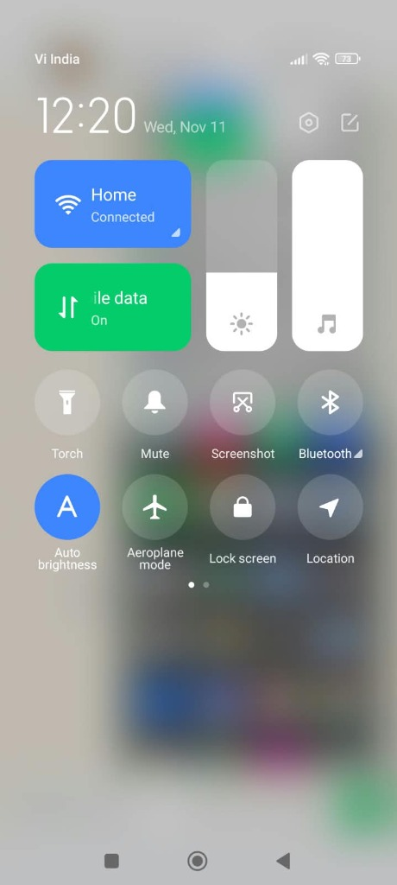
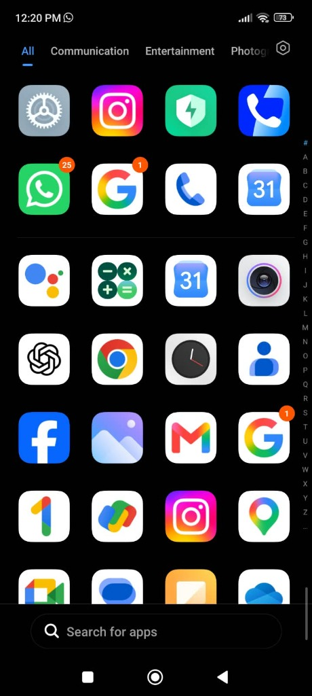

# Clean Stock UI, Control Center & Display Scaling Guide

Removing ads and bloatware gives you a clean software foundation — this guide captures the exact UI layout, Control Center sizing, App Drawer organization, and remaining manual toggles that keep the phone feeling **clean, fast, and uncluttered** on top of the stock MIUI / HyperOS / Android OS.

---

## 1. Modern Control Center + Full-Width Fit Fix (MIUI / HyperOS)

### Turn On the Clean Card-Style Control Center
1. Open **Settings -> Notifications & Control centre -> Control centre style**.
2. Select **New version** (cards for Wi-Fi / Mobile Data + Brightness / Volume sliders + circular quick toggles, separated from Notifications).

> **Important Honesty Note:** ADB cannot turn stock MIUI Control Center into true Android SystemUI or custom-flash iOS graphics. We use MIUI's built-in **New version** Control Center and fix MIUI's display DPI quirk so it renders crisp, readable, and properly proportioned instead of cramped.

### Fix Shrunk / Compressed Control Center Box (The `325dp` / `440 dpi` Lesson)
On **MIUI 14 Global (`Redmi Note 10S`, `1080x2400`)**, changing **Smallest width** or lowering density carelessly can trigger MIUI's Control Center scaling quirk where the quick-toggle container looks capped around `325dp` width instead of fitting comfortably across the screen, or makes labels wrap weirdly.

Recommended balanced proportions (verified on `Redmi Note 10S`, MIUI `14.0.11.0`; untested on HyperOS or other MIUI versions):
- **Display density / Smallest width (`1080p` phones):** `392dp` (`wm density 440` on `1080x2400` physical display — or reset to default stock density with `wm density reset`).
- **Settings -> Display -> Text size:** Set to **Small** (`FONT_SCALE: 1.0` or lower step depending on preference) — keeps `"Mobile data"`, `"Bluetooth"`, and `"Aeroplane mode"` crisp without ugly truncation.

If you test display DPI via ADB (requires `USB debugging (Security settings)` on MIUI):
```bash
adb shell wm density          # Check current Physical vs Override density
adb shell wm density reset    # Safely return to factory display density anytime
```

<p align="center">
  
</p>

---

## 2. Clean Stock-Style Home Screen & App Drawer

1. **Settings -> Home screen -> Home screen mode -> With App drawer**
   - Turn **off** *App suggestions* and *Discover / Mi Browser swipe-up clutter* inside Home screen settings.
   - Manage **App categories** neatly (`Communication`, `Entertainment`, `Photography`, etc.) or disable noisy extra tabs so `All` apps stays tidy.

<p align="center">
  
</p>
2. Keep **Home Screen pages minimal**: place only essentials (Phone, Messages, Chrome, Camera, Gallery/Photos, Maps, daily apps) and use the clean App Drawer for everything else.
3. **Settings -> Home screen -> System navigation:** Choose **Gestures** (modern Pixel/iOS swipe navigation) or classic **Buttons** according to your habit.
4. Set **Google Apps as Defaults** (when using `--tier tier_a_and_b`):
   - **Settings -> Apps -> Manage apps -> 3-dots menu -> Default apps**:
     - Browser: **Chrome**
     - Phone / Dialer: **Phone (Google)**
     - Messaging: **Messages (Google)**
     - Keyboard (**Additional settings -> Languages & input -> Current keyboard**): **Gboard**
     - Gallery / Photos: **Google Photos** or **MIUI Gallery** (pick the one you prefer)

---

## 3. Clean App Icons & Lock Screen

- **Settings -> Themes -> Wallpaper / Lock screen:** Choose a pure dark / minimal AMOLED wallpaper to reduce visual noise and battery draw.
- **Settings -> Lock screen -> Glance for Mi:** Confirm **Turned Off** (Tier A disables `com.miui.android.fashiongallery` so ad carousel stories don't hijack your lock screen).
- **App Drawer / Home icon badges:** Long-press noisy apps or go to **Settings -> Notifications & Control centre -> App notifications** to silence promotional channels while keeping real chats (WhatsApp, SMS, Calls) active.

---

## 4. Network-Level Ad Reduction (Optional, 100% Reversible, No App Needed)

To block most in-app ad banners and third-party trackers across browsers and apps without installing a VPN app:

1. Open **Settings -> Connection & sharing -> Private DNS**.
2. Select **Private DNS provider hostname**.
3. Enter: `dns.adguard-dns.com`
4. Tap **Save**. *(Switch back to `Off` or `Automatic` anytime if a public Wi-Fi captive portal needs login.)*

---

## 5. Manual In-App Ad Toggles on MIUI (Always Double-Check Once)

Even after disabling `com.miui.msa.global` and `com.miui.analytics`, some pre-installed MIUI core apps (like Themes, Security, File Manager, Downloads, Music) keep their own `"Recommendations"` switch inside settings or ignore ADB `settings put`. Toggle these off manually once:

- **Settings -> Passwords & security -> Authorisation & revocation:** Ensure **msa** and **Feedback** are toggled **Off** (if visible).
- **Settings -> Passwords & security -> Privacy -> Ad services:** Turn **Off** *Personalised ad recommendations*.
- **MIUI Security App -> Gear icon (top right):** Turn **Off** *Receive recommendations*.
- **MIUI Cleaner / Boost -> Gear icon:** Turn **Off** *Receive recommendations*.
- **Downloads App -> 3-dots -> Settings:** Turn **Off** *Show recommended content*.
- **Themes App -> Profile -> Settings:** Turn **Off** *Show ads* and *Personalised recommendations*.

---

## 6. Note on Settings Menu Rows (Global MIUI)

On MIUI Global ROMs (verified on `Redmi Note 10S / MIUI 14.0.11.0`), disabling `com.xiaomi.discover` stops the System Apps Updater background app and prevents update nag notifications, **but the static `"System apps updater"` menu row inside Android Settings stays rendered** by MIUI's Settings APK. Tapping it safely does nothing or exits cleanly. That is normal non-root stock OS behavior.
